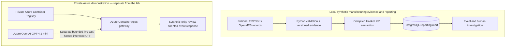

# FDE — Manufacturing Evidence & Azure AI Engineering

**Independent engineering portfolio project · Synthetic data only · Not a client production deployment**

FDE demonstrates a practical forward-deployed engineering workflow: reconcile the meaning of ERP/MES evidence, calculate KPIs deterministically, present an engineer-readable investigation, and deploy a bounded, review-oriented application using Azure.

The project combines **manufacturing context, Haskell/Python/SQL reporting, LangGraph application design, Azure OpenAI, and secure cloud delivery**. AI suggests questions; it does not invent recorded production or authorize operations.

## What has been built

| Workstream | Implemented evidence | Boundary |
| --- | --- | --- |
| Manufacturing integration | Fictional ERPNext/OpenMES evidence; read-only extraction, source identities, typed comparisons | No real plant output or customer system access |
| Reporting | Python intake, compiled Haskell KPI rules, PostgreSQL reporting mart, Excel review | Local synthetic lab, not Azure SQL |
| Workflow and AI | LangGraph coordination, deterministic question/answer path and AG-UI-style event projection | Hosted model inference is disabled |
| Azure OpenAI | GPT-4.1 mini deployment verified; one bounded live synthetic Responses API experiment | Separate from the hosted gateway; not cloud RAG |
| Azure Container Apps | Internal-only gateway provisioned successfully with a ready revision and external ingress disabled | No public endpoint; internal HTTP smoke not yet separately verified |
| Container supply chain | Private Azure Container Registry, immutable digest-pinned image, Entra certificate publisher, least-privilege roles | The production image and Azure permissions are not public here |
| Verification | Local smoke, independent tests, mutation checks, IaC policy, final container scan with zero reported findings | Point-in-time evidence, not enterprise certification |

## Architecture at a glance



The **local KPI workflow and hosted Azure gateway are separate demonstrations**. The deployed Container App is not represented as serving the PostgreSQL mart or performing end-to-end generative RAG.

See [Architecture](docs/ARCHITECTURE.md) for system boundaries and [Azure deployment evidence](docs/AZURE-DEPLOYMENT.md) for the exact scope of cloud verification.

## Run the public deterministic demo

Prerequisites: **Node.js 22**, npm, and (for the full Haskell verification suite) **GHC 9.12.4 / Cabal 3.16.1.0**.

```bash
npm ci
npm run demo
npm run qa:offline
```

The repository also defines `npm run verify` for its broader local verification gate. It may require the Haskell toolchain and additional integration dependencies. The public CI workflow runs deterministic source checks with model invocation disabled.

No Azure credentials, private registry access, or paid model calls are required for the public deterministic demo.

## Engineering choices

- **Deterministic KPI truth:** ERP/MES sources and typed Haskell calculations remain authoritative for numeric findings, not generated text.
- **Human-controlled action:** Suggested questions and investigation handoffs are review-only, never automated changes to vendor systems.
- **Source provenance:** Keep source identity, reporting period, calculation version, and uncertainty visible.
- **Least privilege:** Cloud image publishing uses a dedicated certificate-authenticated identity; the application design uses scoped managed identity and internal ingress.
- **Falsifiable claims:** Use positive and negative tests, adversarial input, targeted mutation checks and infrastructure readbacks rather than equating a build with successful delivery.

## Scope and disclosure

This is an **independent, synthetic-only portfolio implementation**. The public repository contains the reviewed deterministic FDE source, not the private Azure deployment repository, credentials, internal runbooks or a public service URL. The Azure control-plane deployment was independently read back as **Succeeded**, with a ready Container Apps revision and `external: false`; hosted HTTP and end-to-end cloud RAG are not yet verified.

No customer outcomes, physical factory throughput, live employee data, Azure AI Search, AKS, API Management or production availability certification are claimed.

**License:** MIT, as declared in the repository's LICENSE.
