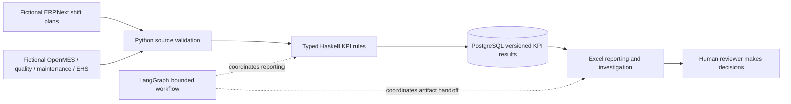
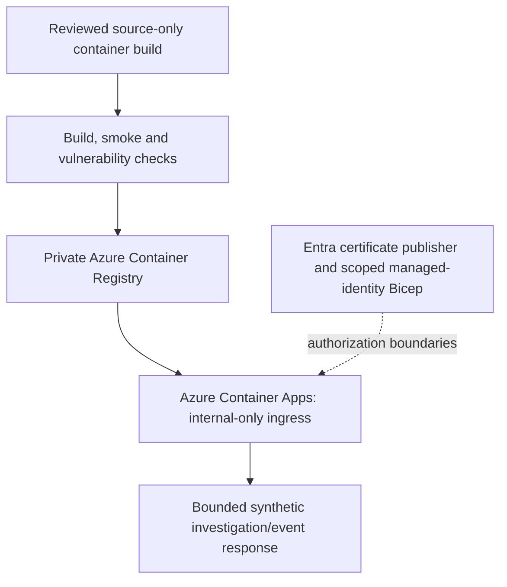

# FDE Architecture — Evidence, Deterministic KPIs and Private Azure Delivery

FDE is an independent portfolio demonstration built on **fictional manufacturing records**. It intentionally separates (1) a deterministic reporting and review application from (2) a hosted private Azure gateway and (3) a bounded Azure OpenAI inference experiment.

## 1. Manufacturing evidence → decision support (local)

**Data authority.** Source systems own observations; Python checks admission, identities and completeness; compiled Haskell owns explicit KPI computations; PostgreSQL retains versioned numeric results; Excel presents reporting; the engineer owns the investigation and decisions. A model cannot turn fictional quantities into physical-production facts.

**Verified local scope.** The synthetic lab used 314 linked fictional shift plans and 2,961 versioned KPI results, with 13 independent mart tests. These are lab outputs, not claims of real factory production or customer adoption.

## 2. Private gateway on Azure Container Apps (deployed)

The source-only private gateway image includes a pinned fictional fixture and intentionally excludes project Markdown and secrets. The final artifact is a non-root, minimal-runtime, digest-pinned image; its final vulnerability scan reported zero matches.

**Azure evidence:** The Container App's Azure control-plane readback returned `Succeeded`, a ready revision and `external: false`. That confirms resource provisioning and a ready revision, not a separately completed HTTP probe from inside the private environment.

The deployment is intentionally **not reachable as a public website**. Basic ACR is authenticated/private by access control, *not* Private Link/network-private.

## 3. Azure OpenAI (separately verified)

A GPT-4.1 mini deployment was provisioned and read back as successful. A single explicitly authorized, bounded synthetic **Responses API** request returned a review-only investigation draft. API-key authentication was disabled and Entra authorization was used.

**Important separation:** hosted Container Apps inference remains **disabled by default**. The live Responses test does not prove a hosted generative answer path, connection from Container Apps to the local PostgreSQL mart, Azure AI Search retrieval, or vector-database-backed cloud RAG.

## Trust boundaries and failure modes

| Boundary | Control | Status or limit |
| --- | --- | --- |
| ERP/MES | Read-only synthetic evidence and typed source identity | Lab implementation; no vendor write effects |
| Metrics | Deterministic Haskell calculations and versioned SQL reporting | No model-computed numerical truth |
| Human review | Review-only question/event outputs | No autonomous ERP/MES changes |
| Cloud ingress | Container Apps `external: false` | Azure readback verified; not an access-control replacement for application authentication |
| Image supply chain | Allowlisted source, immutable digest, scoped ACR publishing, non-root final runtime | Point-in-time scan, not perpetual vulnerability assurance |
| Model access | Entra identity, keys disabled, explicit invocation approval | Separate bounded synthetic live test; hosted model path disabled |
| Cost | Two separately configured monthly budget alert policies | Alerts are not strict monetary caps |
| Telemetry/persistence | No prompt logging and no Table persistence in the private starter by default | Production logging/monitoring is an uncompleted design gate |

## Not demonstrated

No customer production or industrial effect, real employee information, public hosted demo, end-to-end cloud RAG/SQL mart integration, Azure AI Search, AKS, Azure API Management, sustained load, production SLOs, independent private HTTP functional test, or universal security certification.

## Related documents

- [README](../README.md) — recruiter-readable summary and local demo commands.
- [Azure Deployment](AZURE-DEPLOYMENT.md) — facts, evidence levels and deployment boundaries.
